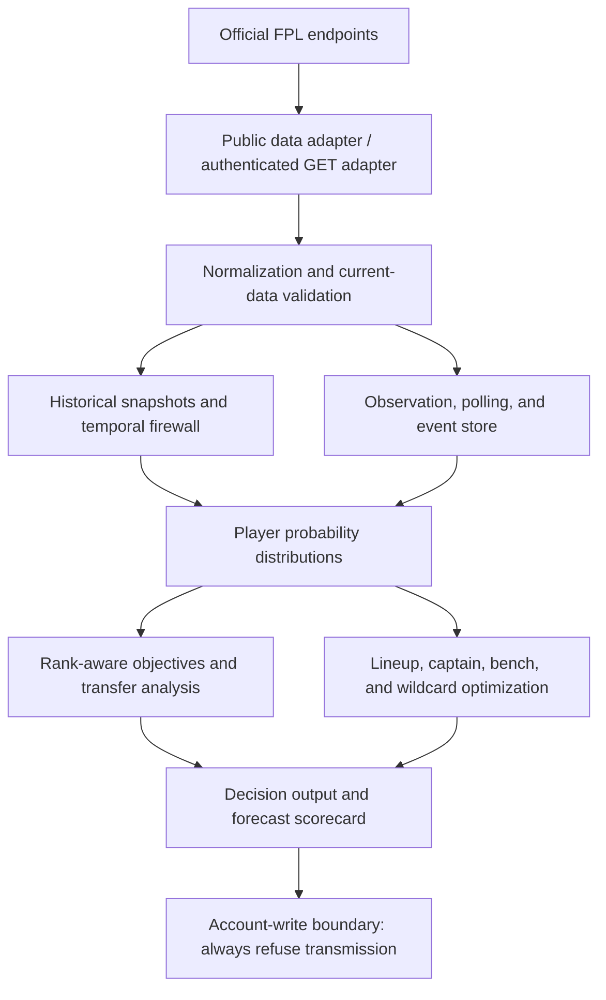

# FPL Skill

[](https://github.com/saaedimam/fpl-skill/actions/workflows/ci.yml)


**A read-oriented Fantasy Premier League toolkit for probabilistic forecasting, constrained squad optimization, transfer analysis, and decision calibration.**

> **Safety contract:** Account mutations are disabled. The execution layer refuses every account write before transmission. A signed approval, an execution mode, a session, or an injected transport cannot enable a write. This repository is an advisory system, not an autonomous FPL account operator.

FPL Skill combines official-data ingestion, player-point distributions, rank-aware decision objectives, a CBC-backed MILP optimizer, historical replay, and forecast calibration. Its outputs are analysis and recommendations; they are not guarantees of future points or rank.

## At a glance

- **Read-only account integration:** public and authenticated reads use GET requests.
- **Probabilistic projections:** point distributions expose percentiles and mathematical expected value.
- **Decision support:** captaincy, bench, transfer, fixture-horizon, and wildcard analysis.
- **Constrained optimization:** squad legality, budget, positional quotas, club limits, and lineup constraints.
- **Current-data gates:** missing, stale, malformed, or contradictory data blocks recommendations where required.
- **Fail-closed execution:** account writes always raise `ExecutionDenied`; no transport is invoked.

## Canonical agent contract

[`SKILL.md`](SKILL.md) is the sole active agent entrypoint and authoritative instruction contract for an FPL agent using this repository.

Archived skill files are historical compatibility material only. They must not be treated as independent or overriding instructions.

## Documentation map (Diátaxis-aligned)

Use the document type that matches the task; these files complement the active agent entrypoint rather than replacing it.

| Type | Documents | Purpose |
| --- | --- | --- |
| Contributor and agent governance | [`AGENTS.md`](AGENTS.md), [`CLAUDE.md`](CLAUDE.md), [`CHATGPT.md`](CHATGPT.md) | Operating constraints, evidence rules, review boundaries, and handoff requirements |
| Explanation / decision record | [`docs/adr/001-fail-closed-execution-firewall.md`](docs/adr/001-fail-closed-execution-firewall.md) | Rationale and evidence for the fail-closed account-write boundary and CI test isolation |
| Reference contracts | [`calibration-contract.md`](contracts/calibration-contract.md), [`GLOBAL15_CONTRACT.md`](contracts/GLOBAL15_CONTRACT.md), [`runtime-contract.md`](contracts/runtime-contract.md), [`source-contract.md`](contracts/source-contract.md), [`decision-contract.md`](contracts/decision-contract.md), [`prediction-contract.md`](contracts/prediction-contract.md), [`research-contract.md`](contracts/research-contract.md) | Normative interfaces, invariants, and evidence rules |
| Machine-readable schema | [`predeadline-snapshot.schema.json`](schemas/predeadline-snapshot.schema.json) | Draft-07 predeadline snapshot data shape |
| Evaluation protocol | [`dataset-contract.md`](docs/evaluation/dataset-contract.md), [`preregistration.md`](docs/evaluation/preregistration.md) | Dataset constraints and preregistered scientific evaluation |

## Scientific Evidence Boundary

Software tests, synthetic fixtures, metric definitions, and retrospective examples establish software behavior or structural validity; they do not establish predictive competence, calibration accuracy, decision uplift, or FPL-winning capability. Those claims require reproducible, leakage-resistant, out-of-sample evaluation against actual outcomes. When outcomes or required joins are missing, report `NO_TRACK_RECORD_YET` or `INSUFFICIENT_DATA`; do not claim `CALIBRATED` or `READY`, and do not impute missing outcomes as `0.0`.

## Safety and execution policy

Account mutation is deliberately unavailable.

`fpl_skill.execution.execute_account_mutation` imports the canonical `fpl_skill.approval_gate.ExecutionDenied`. With a valid approval it may perform read-only bootstrap and account-state fetches during validation; it then discards injected write transport/session objects and raises `ExecutionDenied` before any account-write egress. No approval or execution mode bypasses this refusal. This is a zero-account-write guarantee, not a guarantee of zero network activity.

| Surface | Behavior |
| --- | --- |
| `FPL_MODE=advisory` | Default mode; account mutations are refused |
| `FPL_MODE=approval` | Account mutations are refused |
| `FPL_MODE=autonomous` | Account mutations are refused |
| Signed approval record | May be validated; never authorizes transmission |
| Injected session or transport | Discarded by the execution boundary |
| `all.python --apply` | Refused; no account write is sent |
| Authenticated account adapter | GET-only reads |

The approval issuer and verifier remain as cryptographic evidence and regression-test components. Their presence does **not** mean that live writes are supported. Do not put FPL credentials, cookies, private keys, or approval material in source control, prompts, logs, or issue reports.

The `release/v2.1.0-rc1` reference at `60032d51f16b2646aea1ee95f1cd35f440d1e5d0` is under a repository-governance hold. GitHub currently reports `protected: false`; do not mistake the governance hold for server-side branch protection.

## Architecture



### Expected points are not P50

For a player-point random variable (X):

- `expected_points = E[X] = distribution.mean`
- `P50 = median(X)`

For skewed distributions these values may differ. Expected-value objectives must use the mathematical mean, not P50. Percentile spreads such as `P90 - P50` are valid only when an objective explicitly measures upside or downside.

### Current-data and temporal gates

The current-data layer validates fixture schema, event state, projections, and planning horizons. It distinguishes a true blank from missing or unpublished fixtures. Planning derives its horizon from the current event data; past gameweeks require explicit historical/backtest intent. A missing or invalid required input must not be silently converted into a recommendation.

### Optimization status

The wildcard optimizer builds a constrained MILP using CBC. It is a reduced model, not a proof of full FPL-rule optimality. The project currently keeps `optimality_proven` and `full_rule_optimal` false and reports the result as `NOT_CERTIFIED`. A feasible squad or CBC status alone is not a full-rule optimality certificate.

## Installation

Requires Python 3.11 or newer.

```bash
git clone https://github.com/saaedimam/fpl-skill.git
cd fpl-skill

python3 -m venv .venv
source .venv/bin/activate

python -m pip install --upgrade pip
pip install -r requirements.txt
pip install .
```

The package exposes the `fpl` command. The commands above match the CI installation sequence; `requirements.txt` delegates to the repository's pinned compatibility lockfile. For editable local development, install the declared development extra instead:

```bash
pip install -e ".[dev]"
```

## Configuration

For account-specific read commands, set your FPL entry ID:

```bash
export FPL_TEAM_ID=YOUR_ENTRY_ID
export FPL_MODE=advisory
```

Authenticated reads may use the FPL session cookie from the macOS Keychain. Store credentials outside the repository. The adapter uses the Keychain item with service `fpl-agent` and account `auth/session` when available:

```bash
security add-generic-password -s fpl-agent -a auth/session -w
```

The command prompts for the value. Treat this cookie as a full account session. Never commit it or print it to logs. On non-macOS systems, use a secure credential mechanism appropriate to that platform; do not put secrets in tracked files.

## CLI

The packaged command is `fpl`. You can also run it as `python -m fpl_skill.cli`.

### Read-only prediction

```bash
# Predict the next eligible gameweek using account state
fpl predict

# Predict using 15 explicit element IDs
fpl predict --squad-ids 1,2,3,4,5,6,7,8,9,10,11,12,13,14,15

# Select a target gameweek explicitly
fpl predict --gw 10 --squad-ids 1,2,3,4,5,6,7,8,9,10,11,12,13,14,15
```

Predictions are current-data gated. If required fixture or projection data is invalid, the CLI prints `CURRENT-DATA GATE FAILED` and exits with code `3`. A blocked account state exits with code `2`.

### Verify account state

```bash
export FPL_TEAM_ID=YOUR_ENTRY_ID
fpl verify
```

This reads and reports the available account-state classification. It does not change the account.

### Calibration

```bash
fpl calibrate
fpl calibrate --gw 10
fpl calibrate --by-category
```

Calibration requires enough completed-gameweek and player-forecast observations. Until the sample gate is met, the CLI reports the reason rather than implying that the model is calibrated.

### Backtesting

```bash
fpl backtest-captain --gw 10
fpl backtest-bench --gw 10
fpl backtest-transfer --gw 10 --bank 0.5
```

Backtests require valid historical inputs and current-data checks appropriate to the target event. They produce analysis and records, not account writes.

## Tests and network isolation

The CI workflow supports Python 3.11–3.14. It verifies the release manifest, compiles the package, proves external egress is blocked inside a Linux network namespace, and runs pytest inside a fresh namespace with loopback enabled.

Run the ordinary local suite:

```bash
python -m pytest tests/ -v -ra
python -m compileall fpl_skill
```

The exact CI isolation sequence uses two separate fresh namespaces. First, CI proves external TCP egress is blocked:

```bash
PYTHON_BIN="$(command -v python)"
sudo unshare --net -- env \
  PATH="$PATH" \
  LD_LIBRARY_PATH="${LD_LIBRARY_PATH:-}" \
  PYTHON_BIN="$PYTHON_BIN" \
  bash -c 'ip link set lo up && "$PYTHON_BIN" tests/prove_netns_egress_denied.py'
```

Then CI runs pytest in a separate loopback-only namespace with `FPL_TEST_NETNS=1`:

```bash
PYTHON_BIN="$(command -v python)"
sudo unshare --net -- env \
  PATH="$PATH" \
  LD_LIBRARY_PATH="${LD_LIBRARY_PATH:-}" \
  PYTHON_BIN="$PYTHON_BIN" \
  FPL_TEST_NETNS=1 \
  bash -c 'ip link set lo up && "$PYTHON_BIN" -m pytest tests/ -ra'
```

See [`tests/README.md`](tests/README.md) and [`.github/workflows/ci.yml`](.github/workflows/ci.yml) for the exact CI implementation. These namespaces are CI test-isolation controls, not a production runtime sandbox.

The test monkeypatches in `tests/network_isolation.py` are defense in depth, not a kernel security boundary. C extensions, subprocesses, `ctypes`/libc calls, previously bound methods, and alternate HTTP clients can bypass Python-level patches. Use the network namespace for a hard egress boundary.

### Test environment variables

| Variable | CI behavior | Meaning / safe handling |
| --- | --- | --- |
| `FPL_LIVE_TEST` | Not set | Separate opt-in live-data test flag; keep unset for automated testing. |
| `FPL_TEST_NETNS` | Set to `1` for namespaced pytest | Enables the namespace-aware test proof in the isolated pytest process. |
| `FPL_ALLOW_TEST_NETWORK` | Not set | Local test-only monkeypatch opt-out; not a CI setting or account-write authorization. |
| `FPL_CONFIRM_LIVE_NETWORK` | Not set | Must accompany `FPL_ALLOW_TEST_NETWORK=1` with the exact confirmation value below; not used by CI. |

Disabling the local pytest monkeypatch requires **both** of the following exact environment values:

```bash
FPL_ALLOW_TEST_NETWORK=1
FPL_CONFIRM_LIVE_NETWORK=I-understand-this-is-not-a-security-boundary
```

`FPL_ALLOW_TEST_NETWORK=1` alone is insufficient. Both values are ignored when `CI` or `GITHUB_ACTIONS` is set. This opt-out disables only the Python monkeypatch on a developer machine; it does not disable a network namespace or enable production account writes. Do not use it for routine tests. `FPL_LIVE_TEST=1` is a separate opt-in live-data test flag and must remain unset for automated CI and under the current account-write governance hold.

## Release integrity

The active registry is [`MANIFEST.v2.json`](MANIFEST.v2.json); the packaged copy at `fpl_skill/MANIFEST.v2.json` must be identical.

The release verifier checks:
1. Required safety paths are present.
2. The root and packaged manifests match.
3. Every registered file's SHA-256 matches its declared hash.
4. The derived release hash matches the manifest.

Run the read-only verifier (the exact command used by CI):

```bash
python -c "from tests.compute_release_hash import verify_release_integrity; verify_release_integrity()"
```

This command checks existing manifest coverage, canonical raw-byte file hashes, and the derived release hash without writing files. The separate `python3 tests/compute_release_hash.py` command verifies reproducibility and writes `tests/release_hash.json`; it does not regenerate the root or packaged manifest metadata.

When a registered file changes, regenerate the release metadata with:

```bash
python tests/compute_release_hash.py
```

That command writes `tests/release_hash.json`; update and validate both manifest copies as required by the repository's release process. Never remove required safety paths merely to make the hash pass.

## Repository map

| Path | Purpose |
| --- | --- |
| `SKILL.md` | Canonical agent contract |
| `fpl_skill/account_adapter.py` | Public and authenticated GET-only account reads |
| `fpl_skill/current_data.py` | Fixture, event, and projection validation |
| `fpl_skill/probabilistic_ep1.py` | Player-point probability distributions |
| `fpl_skill/rank_aware_objective1.py` | Rank-aware strategic objectives |
| `fpl_skill/optimizer.py` | CBC-backed wildcard MILP |
| `fpl_skill/transfer_intelligence.py` | Transfer value and horizon analysis |
| `fpl_skill/observation/` | Polling, snapshots, event storage, and alerts |
| `fpl_skill/historical/` | Snapshot provenance, replay, and temporal firewall |
| `fpl_skill/forecast_scorecard.py` | Forecast calibration metrics |
| `fpl_skill/execution.py` | Permanently fail-closed account-mutation boundary |
| `tests/` | Unit, regression, safety, and release-integrity tests |
| `contracts/` | Formal runtime, source, prediction, and decision contracts |
| `MANIFEST.v2.json` | Canonical release file registry |

## Contracts and supporting documents

- [Source authority contract](contracts/source-contract.md)
- [Decision contract](contracts/decision-contract.md)
- [Prediction contract](contracts/prediction-contract.md)
- [Runtime contract](contracts/runtime-contract.md)
- [Calibration contract](contracts/calibration-contract.md)
- [Wildcard MILP contract](contracts/GLOBAL15_CONTRACT.md)
- [Evidence policy](evidence/evidence-policy.md)
- [Test isolation notes](tests/README.md)
- [Changelog](CHANGELOG.md)

## Scope and limitations

- Projections are model estimates, not guarantees.
- Data quality and official FPL schema changes can affect outputs.
- Calibration quality depends on sufficient, representative observations.
- The wildcard formulation is a reduced model and is not certified as full-rule optimal.
- Account writes are disabled by design; this project must not be represented as an auto-transfer or autonomous account-execution bot.

## License

MIT. See [LICENSE](LICENSE).

## Evidence boundary

See the [Scientific Evidence Boundary](#scientific-evidence-boundary) above. Test success and synthetic structural validation are not a predictive track record.
