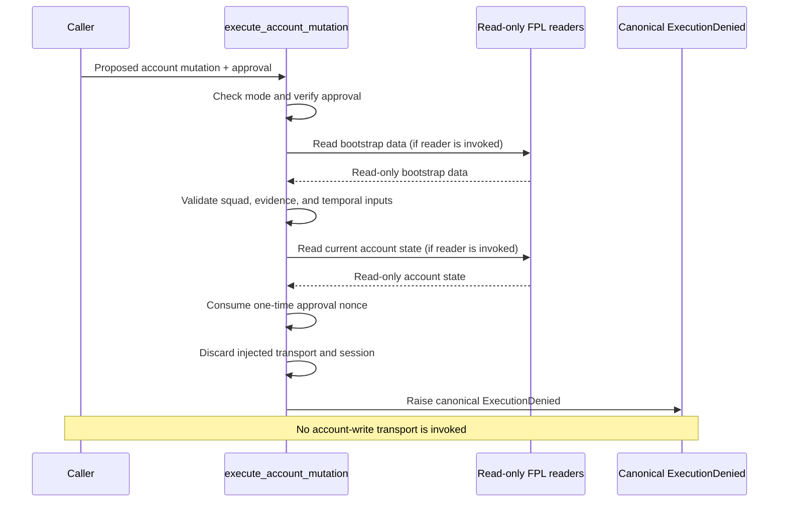

# ADR-001: Fail-Closed Account Execution Firewall and Zero-Egress Verification

**Status: Proposed — documenting the existing fail-closed implementation and CI isolation evidence. This ADR is not accepted until reviewed and merged.**

- **Date:** 2026-11-21
- **Baseline:** `main` at `d707a3a51494cae75ea6a5d1e873aa61fcb34851`
- **Scope:** Account-write refusal behavior and CI test-process network isolation
- **Diátaxis mode:** Explanation and reference

## Context

The repository is an advisory FPL toolkit. Authenticated account reads may be used to obtain current state, but live account writes remain disabled. The execution boundary must not transmit a proposed lineup, transfer, chip, or other account mutation, even when a valid approval record and injected transport/session objects are supplied.

The test suite also needs a kernel-enforced network boundary. Python monkeypatches are useful defense in depth on developer machines but can be bypassed by C extensions, subprocesses, `ctypes`/libc calls, previously bound methods, or alternate HTTP clients. CI therefore runs dedicated network-isolation checks in Linux network namespaces.

## Current implementation and refusal sequence

`fpl_skill.execution.execute_account_mutation` imports the canonical `ExecutionDenied` from `fpl_skill.approval_gate`. It does not define a second exception class. For a request that passes the preceding mode, approval, squad, evidence, temporal, account-state, and nonce checks, the relevant sequence is:



In the current implementation, the default bootstrap and account-state readers perform read-only fetches on the path with a valid approval. Injected reader callbacks may be supplied for tests. Earlier validation failures may raise `ExecutionDenied` before those reads. Therefore, the guarantee is **zero account-write egress**, not zero network access of every kind. Read-only bootstrap/account-state fetches may occur before the final refusal.

The injected write `transport` and `session` are deleted from the function's local references before the final `ExecutionDenied` is raised. The transport is never called. No execution mode, approval record, or session enables transmission.

## CI network-isolation controls

CI uses two distinct fresh network namespaces. These are test-process isolation controls, not a production runtime sandbox.

### 1. Dedicated external-egress probe

The workflow runs `tests/prove_netns_egress_denied.py` inside a namespace with loopback enabled:

```bash
PYTHON_BIN="$(command -v python)"
sudo unshare --net -- env \
  PATH="$PATH" \
  LD_LIBRARY_PATH="${LD_LIBRARY_PATH:-}" \
  PYTHON_BIN="$PYTHON_BIN" \
  bash -c 'ip link set lo up && "$PYTHON_BIN" tests/prove_netns_egress_denied.py'
```

The probe confirms loopback works and that an external TCP connection fails. It is a specific connectivity assertion, not a general proof about production runtime configuration.

### 2. Pytest inside a separate namespace

The workflow then runs the suite in a separate fresh namespace with `FPL_TEST_NETNS=1`:

```bash
PYTHON_BIN="$(command -v python)"
sudo unshare --net -- env \
  PATH="$PATH" \
  LD_LIBRARY_PATH="${LD_LIBRARY_PATH:-}" \
  PYTHON_BIN="$PYTHON_BIN" \
  FPL_TEST_NETNS=1 \
  bash -c 'ip link set lo up && "$PYTHON_BIN" -m pytest tests/ -ra'
```

The `FPL_TEST_NETNS=1` flag enables the test's namespace-aware `libc connect(2)` / `ENETUNREACH` proof. The Python monkeypatch remains defense in depth; it is not the kernel boundary. See [`tests/README.md`](../../tests/README.md) and [the CI workflow](../../.github/workflows/ci.yml).

Disabling the local pytest monkeypatch requires both `FPL_ALLOW_TEST_NETWORK=1` and `FPL_CONFIRM_LIVE_NETWORK=I-understand-this-is-not-a-security-boundary`. One value alone is insufficient; both are ignored when `CI` or `GITHUB_ACTIONS` is set. This developer opt-out does not disable a namespace or enable production writes. `FPL_LIVE_TEST=1` is a separate live-data test opt-in and must remain unset for automated CI and under the current account-write governance hold.

## Release-integrity verification

The read-only verifier used by CI is:

```bash
python -c "from tests.compute_release_hash import verify_release_integrity; verify_release_integrity()"
```

It checks required safety-path coverage, root/package manifest equality, canonical raw-byte file digests, and the derived release hash without writing files. `python3 tests/compute_release_hash.py` is the separate reproducibility/evidence command and writes `tests/release_hash.json`; it verifies existing manifest metadata and does not regenerate the manifest's declared file hashes.

## Scientific Evidence Boundary

Passing software tests, synthetic fixtures, metric definitions, or retrospective examples does not establish predictive competence, calibration accuracy, decision uplift, or FPL-winning capability. Such claims require reproducible, leakage-resistant, out-of-sample evaluation against actual outcomes. Missing outcomes or incomplete joins must remain `NO_TRACK_RECORD_YET` or `INSUFFICIENT_DATA`; do not label the system `CALIBRATED` or `READY`, and do not impute missing outcomes as `0.0`.

## Decision and consequences

This proposal documents two separate controls already present on the baseline:

1. The application-level execution boundary refuses account-write transmission by discarding injected write transport/session objects and raising the canonical exception.
2. CI verifies test-process network isolation with a dedicated egress probe and a separate namespaced pytest run.

The controls are complementary and must not be conflated. A successful CI run demonstrates that the tested suite passed under the CI isolation procedure; it does not establish predictive performance, guarantee production network isolation, or authorize Phase 3/live account writes. Those remain **STRICT HOLD**.

## Verification references

- [`fpl_skill/execution.py`](../../fpl_skill/execution.py)
- [`fpl_skill/approval_gate.py`](../../fpl_skill/approval_gate.py)
- [`tests/test_execution_firewall.py`](../../tests/test_execution_firewall.py)
- [`tests/prove_netns_egress_denied.py`](../../tests/prove_netns_egress_denied.py)
- [`tests/network_isolation.py`](../../tests/network_isolation.py)
- [`.github/workflows/ci.yml`](../../.github/workflows/ci.yml)
- [`tests/compute_release_hash.py`](../../tests/compute_release_hash.py)
